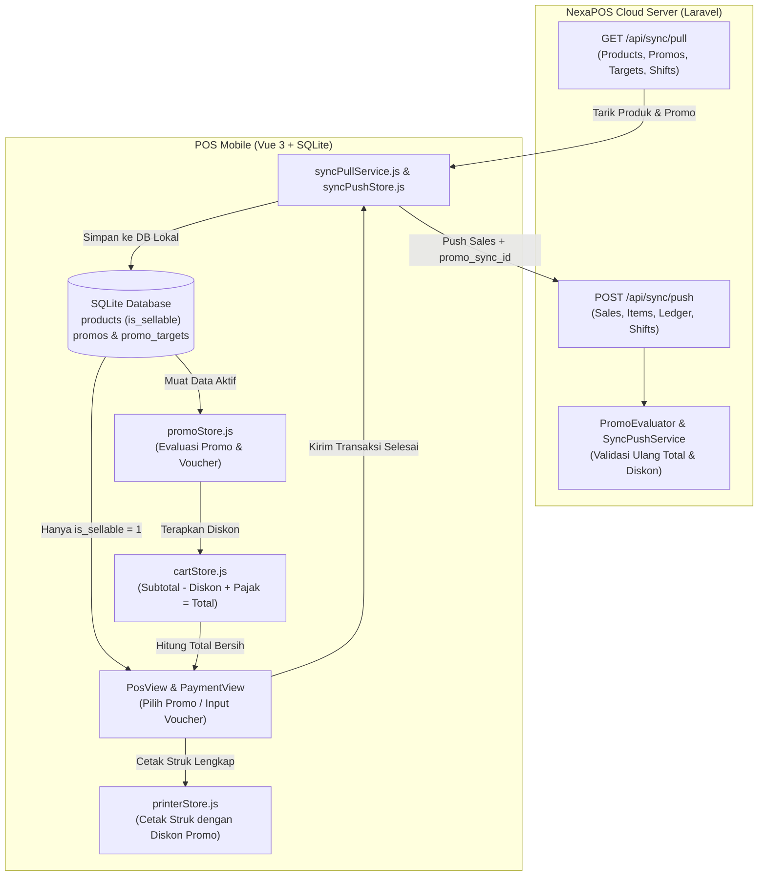
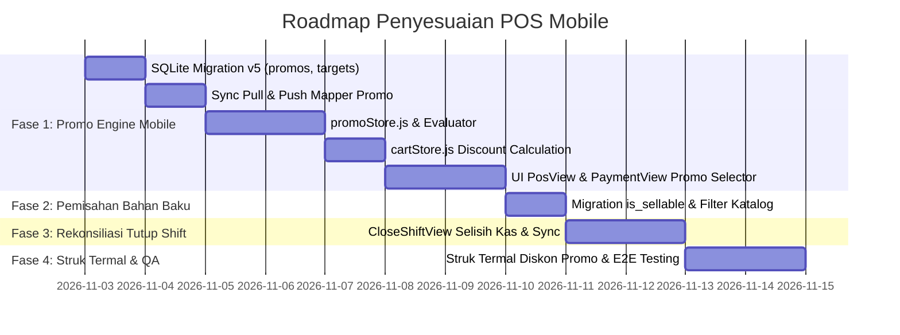

# Roadmap & Spesifikasi Penyesuaian Fitur: POS Mobile Parity dengan Web Dashboard

> **Dokumen Referensi & Rencana Aksi Sinkronisasi Fitur Antara Web Dashboard/POS dan Aplikasi POS Mobile**  
> **Target Aplikasi Mobile**: `D:\PROJECT WEB\POS OFFLINE\pos-mobile` (Vue 3 + Pinia + Capacitor SQLite)  
> **Target Aplikasi Backend / Web**: `D:\PROJECT WEB\POS OFFLINE\pos_dashboard` (Laravel 12 + Livewire + Blade)  
> **Status**: 🚀 PHASE 1, 2, & 5 COMPLETED (Pull Request #71 in `pos-mobile`)

---

## 1. Latar Belakang & Tujuan

Dalam beberapa fase pengembangan terakhir, **NexaPOS Dashboard (Web)** telah menambahkan sejumlah fitur krusial:
1. **Promo Engine Server-Defined** (Diskon otomatis, kupon voucher, persentase/nominal/harga khusus, happy hour, kuota promo).
2. **Kalkulasi HPP & Resep / BOM (Bill of Materials)** dengan pemisahan tegas antara Produk Dijual (`is_sellable = true`) dan Persediaan Bahan Baku (`is_sellable = false`).
3. **Zona Kasir Web (Web POS)** dengan rekonsiliasi kas shift (modal awal, kas masuk/keluar, selisih kas), pencetakan struk termal, dan shortcut kasir.
4. **PWA (Progressive Web App)** untuk web dashboard dan kasir.
5. **NexaBot AI Guide Chatbot** terintegrasi.

Agar pengalaman kasir di **POS Mobile (Android / Tablet)** memiliki fitur yang setara (*feature parity*), tidak terjadi desinkronisasi data, dan transaksi offline di mobile tetap valid saat disinkronkan ke server Cloud, dokumen ini memetakan seluruh gap fitur dan langkah penyesuaian teknis yang harus diterapkan pada `pos-mobile`.

---

## 2. Matriks Gap & Penyesuaian Fitur (Web vs Mobile)

| Domain Fitur | Status di Web Dashboard | Status Saat Ini di POS Mobile | Kebutuhan Penyesuaian di POS Mobile | Status Implementasi |
|---|---|---|---|:---:|
| **1. Promo & Diskon** | ✅ Engine promo lengkap (`promos`, `promo_targets`, validasi syarat belanja, kuota, happy hour) | ✅ Engine promo offline lengkap (`promoStore`, `evaluatePromoDiscount`, modal voucher, cart subtotal/tax). | SQLite migration v5, adapter promo, cart discount computation, contract push/pull. | ✅ **Selesai (PR #71)** |
| **2. Pemisahan Produk vs Bahan Baku** | ✅ Kolom `is_sellable`. Bahan baku tidak muncul di menu kasir. | ✅ Kolom `is_sellable` aktif di SQLite. Filter katalog otomatis sembunyikan bahan baku/supplies. | Tambah kolom `is_sellable` di SQLite, filter katalog kasir hanya `is_sellable = 1`. | ✅ **Selesai (PR #71)** |
| **3. Tutup Shift & Selisih Kas** | ✅ Rekonsiliasi kas: modal awal, uang terhitung, estimasi sistem, selisih kas (`discrepancy`), catatan selisih. | ⚠️ Tutup shift ada, namun perhitungan `discrepancy` dan pelaporan selisih belum selaras penuh dengan kontrak sync. | Selaraskan kalkulasi `expected_cash`, input `actual_cash`, hitung `discrepancy`, dan kirim pada payload `shifts`. | 🟡 **Next (Phase 3)** |
| **4. Metode Pembayaran & Kembalian** | ✅ Tunai (pecahan cepat), QRIS (statis/dinamis), Transfer Bank, Kartu Debit/Kredit EDC. | ⚠️ Pembayaran dasar ada, perlu standardisasi kode enum pembayaran (`cash`, `qris`, `transfer`, `card`). | Standarisasi enum pembayaran, pencatatan otomatis ke `cash_ledger` khusus untuk transaksi tunai. | 🟡 **Next (Phase 4)** |
| **5. Format Struk Termal (ESC/POS)** | ✅ Format 58mm/80mm rapi: info outlet, kasir, baris diskon promo, pajak, total, pembayaran, kembalian. | ✅ Rincian diskon promo tercetak di struk layar (`ReceiptContent.vue`) dan print ESC/POS thermal 58mm/80mm. | Tambahkan baris diskon promo, nama promo, dan potongan harga pada layout struk. | ✅ **Selesai (PR #71)** |
| **6. Pelanggan & Kuota Promo** | ✅ Pelanggan terhubung ke transaksi, riwayat belanja, dan kuota promo per pelanggan. | ⚠️ Autocomplete pelanggan ada, namun belum divalidasi ke pemakaian promo. | Hubungkan ID pelanggan terpilih ke kalkulator promo untuk memeriksa kuota promo pelanggan. | 🟢 **P2 (Medium)** |

---

## 3. Rencana Aksi Detail per Domain



---

### FASE 1: Penyesuaian Promo Engine pada POS Mobile (Prioritas Utama)

#### 1.1 Skema SQLite Mobile (Migration v5)
File target: `D:\PROJECT WEB\POS OFFLINE\pos-mobile\src\services\database\schema.js`
Tambahkan migration versi 5:
```sql
CREATE TABLE IF NOT EXISTS promos (
  id TEXT PRIMARY KEY NOT NULL,
  business_id INTEGER NOT NULL,
  name TEXT NOT NULL,
  code TEXT NULL,
  discount_type TEXT NOT NULL, /* percent | fixed | price_override */
  discount_value INTEGER NOT NULL, /* basis point untuk percent (1000 = 10%), nominal rupiah untuk fixed */
  scope TEXT NOT NULL DEFAULT 'all', /* all | product | category */
  min_purchase REAL NOT NULL DEFAULT 0,
  max_discount REAL NULL,
  weekdays TEXT NULL, /* JSON string: [1,2,3,4,5,6,7] */
  starts_at TEXT NULL,
  ends_at TEXT NULL,
  start_time TEXT NULL, /* HH:MM */
  end_time TEXT NULL,   /* HH:MM */
  usage_limit_total INTEGER NULL,
  usage_limit_per_customer INTEGER NULL,
  priority INTEGER NOT NULL DEFAULT 0,
  is_stackable INTEGER NOT NULL DEFAULT 0,
  status TEXT NOT NULL DEFAULT 'draft',
  sync_id TEXT NOT NULL,
  updated_at TEXT NOT NULL
);

CREATE TABLE IF NOT EXISTS promo_targets (
  id TEXT PRIMARY KEY NOT NULL,
  promo_id TEXT NOT NULL,
  target_type TEXT NOT NULL, /* product | category */
  target_id TEXT NOT NULL,
  created_at TEXT NOT NULL
);

CREATE INDEX IF NOT EXISTS idx_promos_status ON promos(status);
CREATE INDEX IF NOT EXISTS idx_promo_targets_promo_id ON promo_targets(promo_id);
```

#### 1.2 Sinkronisasi Pull Promo
File target: `D:\PROJECT WEB\POS OFFLINE\pos-mobile\src\services\sync\syncPullService.js`
- Daftarkan entity `promos` dan `promo_targets` pada handler pull sinkronisasi.
- Simpan record promo dari server ke tabel SQLite lokal `promos` dan `promo_targets`.
- Hapus peringatan `warnings.push('UNSUPPORTED_LOCAL_SALE_DISCOUNT_FIELD')` dan gantikan dengan pemetaan nilai `discount_amount` ke transaksi historis.

#### 1.3 Pembuatan Store Promo Mobile (`src/stores/promoStore.js`)
Buat store Pinia baru untuk mengevaluasi promo secara offline:
- **`activePromos`**: Mengambil promo yang `status === 'active'`, tanggal sekarang berada di antara `starts_at` dan `ends_at`, hari ini cocok dengan `weekdays`, dan jam sekarang sesuai `start_time` - `end_time` (Happy Hour).
- **`evaluateCartPromo(cartItems, customerId = null)`**:
  - Mengevaluasi apakah subtotal keranjang memenuhi `min_purchase`.
  - Jika scope `all`: diskon dihitung dari seluruh subtotal.
  - Jika scope `product`: diskon hanya dihitung dari item produk yang terdaftar di `promo_targets`.
  - Jika scope `category`: diskon dihitung dari item kategori yang terdaftar di `promo_targets`.
  - Jika tipe `percent`: `discount = (eligibleAmount * discountValue) / 10000`, lalu di-cap dengan `max_discount` bila ada.
  - Jika tipe `fixed`: `discount = min(discountValue, eligibleAmount)`.
- **`applyPromoByCode(code)`**: Mencari promo aktif berdasarkan kode kupon voucher yang dimasukkan kasir.

#### 1.4 Penyesuaian Keranjang Kasir (`src/stores/cartStore.js`)
File target: `D:\PROJECT WEB\POS OFFLINE\pos-mobile\src\stores\cartStore.js`
- Tambahkan state: `appliedPromo: null` (menyimpan object promo aktif yang dipilih).
- Tambahkan getters:
  ```javascript
  discount: (state) => {
    if (!state.appliedPromo) return 0;
    // Panggil logika kalkulasi diskon dari promoStore
    return promoStore.calculateDiscount(state.appliedPromo, state.items);
  },
  taxableSubtotal() {
    return Math.max(0, this.subtotal - this.discount);
  },
  tax() {
    const taxStore = useTaxStore();
    return Math.round(this.taxableSubtotal * taxStore.effectiveRate / 100);
  },
  total() {
    return this.taxableSubtotal + this.tax;
  }
  ```
- Tambahkan actions: `setPromo(promo)`, `clearPromo()`.

#### 1.5 Penyesuaian Antarmuka Kasir Mobile (`PosView.vue` & `PaymentView.vue`)
- Di bagian ringkasan keranjang (`PosView.vue`):
  - Tampilkan baris **"Promo / Kupon"** dengan tombol pintas *"Pilih Promo"* atau ikon diskon.
  - Jika promo aktif terpilih, tampilkan nama promo, badge diskon hijau, dan tombol hapus promo (✕).
  - Tampilkan rincian: Subtotal, Diskon Promo (-Rp XX.XXX), Pajak, dan Total Akhir.
- Di modal pembayaran (`PaymentView.vue`):
  - Pastikan nominal yang ditagihkan adalah `cartStore.total` (setelah dipotong diskon).

#### 1.6 Kontrak Sinkronisasi Push (`contractMapper.js`)
File target: `D:\PROJECT WEB\POS OFFLINE\pos-mobile\src\services\sync\contractMapper.js`
- Ubah baris `discount_amount: 0` menjadi:
  ```javascript
  discount_amount: payload.discount || 0,
  promo_sync_id: payload.promo_sync_id || null,
  ```
- Sertakan entitas relasi `promotions`:
  ```javascript
  promotions: payload.appliedPromo ? [{
    promo_sync_id: payload.appliedPromo.sync_id,
    discount_amount: payload.discount,
    promo_name: payload.appliedPromo.name
  }] : []
  ```
- Ini menjamin verifikasi `SyncAuthorizationPolicy::sale_total_mismatch` dan `promo_discount_mismatch` di server Laravel menerima data yang 100% konsisten.

---

### FASE 2: Pemisahan Bahan Baku (Supplies) & Non-Sellable Items

#### 2.1 Masalah Saat Ini
Web Dashboard membedakan Produk Dijual (`is_sellable = true`) dengan Persediaan Bahan Baku Mentah (`is_sellable = false`, contoh: tepung, biji kopi kiloan, sirup, cup plastik). Jika mobile tidak memfilter kolom `is_sellable`, kasir di mobile dapat keliru menjual bahan mentah langsung ke pelanggan.

#### 2.2 Langkah Penyesuaian
1. **Migration SQLite**:
   ```sql
   ALTER TABLE products ADD COLUMN is_sellable INTEGER NOT NULL DEFAULT 1;
   ```
2. **Pull Sync (`contractMapper.js` & `syncPullService.js`)**:
   Petakan `is_sellable` dari response JSON produk Cloud (default `1` jika true, `0` jika false).
3. **Filter Katalog Kasir (`productStore.js`)**:
   ```javascript
   // Filter hanya produk aktif yang memang diizinkan dijual di POS
   getters: {
     sellableProducts: (state) => state.products.filter(p => p.is_active && (p.is_sellable === undefined || p.is_sellable === 1)),
   }
   ```
4. **Form Produk Mobile (`ProductFormView.vue`)**:
   Tambahkan toggle: *"Dijual di Kasir POS"* (jika dimatikan, item diperlakukan sebagai stok persediaan/bahan baku).

---

### FASE 3: Rekonsiliasi Tutup Shift & Pencatatan Kas

#### 3.1 Alur Tutup Shift Standar
File target: `D:\PROJECT WEB\POS OFFLINE\pos-mobile\src\views\shift\CloseShiftView.vue`
1. **Perhitungan Otomatis Sistem**:
   - `starting_cash`: Uang modal awal saat buka shift.
   - `cash_sales_total`: Total penjualan transaksi tunai selama shift berlangsung.
   - `cash_in`: Total kas masuk operasional tambahan.
   - `cash_out`: Total pengeluaran kas / uang keluar.
   - `expected_cash = starting_cash + cash_sales_total + cash_in - cash_out`.
2. **Input Kasir**:
   - Kasir menghitung uang fisik di laci (*cash count*) dan menginputkan `actual_cash`.
3. **Kalkulasi Selisih**:
   - `difference = actual_cash - expected_cash`.
   - Jika `difference === 0`: Status Kas Cocok (*Balanced*).
   - Jika `difference > 0`: Status Selisih Lebih (*Surplus*).
   - Jika `difference < 0`: Status Selisih Kurang (*Shortage*).
   - Jika ada selisih, kasir diwajibkan mengisi kolom `notes` (alasan/keterangan selisih).
4. **Push Sinkronisasi**:
   Kirim data penutupan shift ke Cloud:
   `status = 'closed'`, `ended_at = now()`, `expected_cash`, `actual_cash`, `difference`, `notes`.

---

### FASE 4: Struk Termal Kasir (ESC/POS Bluetooth & Web Printing)

File target: `D:\PROJECT WEB\POS OFFLINE\pos-mobile\src\stores\printerStore.js` & `ReceiptView.vue`
Perbarui format cetak struk agar identik dengan Web POS:
```text
================================
           NexaPOS
        Kopi Nusantara
     Cabang Utama - Jakarta
================================
No: TRX-20261102-0014
Waktu: 02/11/2026 21:30
Kasir: Budi
Pelanggan: Andi
--------------------------------
Kopi Americano (L)
  2 x 18.000             36.000
Croissant Cokelat
  1 x 25.000             25.000
--------------------------------
Subtotal                 61.000
Diskon (PROMO SENIN)    -10.000
Pajak PB1 (10%)           5.100
--------------------------------
TOTAL TAGIHAN            56.100
TUNAI                   100.000
KEMBALIAN                43.900
================================
   Terima Kasih Atas Kunjungan Anda!
   Simpan Struk Ini Sebagai Bukti
================================
```

---

## 4. Rencana Kerja Eksekusi Bertahap (Sprint Breakdown)



### Milestone & Checklist:
- [ ] **Milestone 1**: SQLite schema migrasi v5 siap di `pos-mobile` dengan tabel `promos` dan `promo_targets`.
- [ ] **Milestone 2**: `syncPullService.js` berhasil mengunduh promo aktif dari Cloud ke database SQLite mobile tanpa warning.
- [ ] **Milestone 3**: `promoStore.js` dapat mengevaluasi syarat belanja, kupon voucher, dan batas diskon.
- [ ] **Milestone 4**: Kasir di mobile dapat memilih promo di keranjang dan melihat potongan diskon otomatis.
- [ ] **Milestone 5**: Transaksi dari mobile berhasil di-push ke Cloud dengan `discount_amount` & `promo_sync_id` tervalidasi sukses (bebas mismatch error).
- [ ] **Milestone 6**: Bahan mentah non-jual (`is_sellable = 0`) otomatis disembunyikan dari katalog menu kasir.
- [ ] **Milestone 7**: Tutup shift di mobile menghitung selisih kas fisik vs sistem secara akurat.
- [ ] **Milestone 8**: Struk cetak Bluetooth thermal menyertakan baris nama dan nominal promo.

---

## 5. Referensi File Kunci

- **Spesifikasi Server Promo Engine**: [`docs/inventory/PROMO_D01_PROMO_ENGINE.md`](file:///d:/PROJECT%20WEB/POS%20OFFLINE/pos_dashboard/docs/inventory/PROMO_D01_PROMO_ENGINE.md)
- **Kontrak Sinkronisasi Kasir**: [`docs/sync/INT01_CASHIER_SYNC_V1.md`](file:///d:/PROJECT%20WEB/POS%20OFFLINE/pos_dashboard/docs/sync/INT01_CASHIER_SYNC_V1.md)
- **Implementasi Evaluator Backend**: [`app/Services/Promo/PromoEvaluator.php`](file:///d:/PROJECT%20WEB/POS%20OFFLINE/pos_dashboard/app/Services/Promo/PromoEvaluator.php)
- **Basis Pengetahuan NexaBot AI**: [`app/Services/Chatbot/NexaPosKnowledgeBase.php`](file:///d:/PROJECT%20WEB/POS%20OFFLINE/pos_dashboard/app/Services/Chatbot/NexaPosKnowledgeBase.php)
- **Source Code Mobile App**: `D:\PROJECT WEB\POS OFFLINE\pos-mobile`

